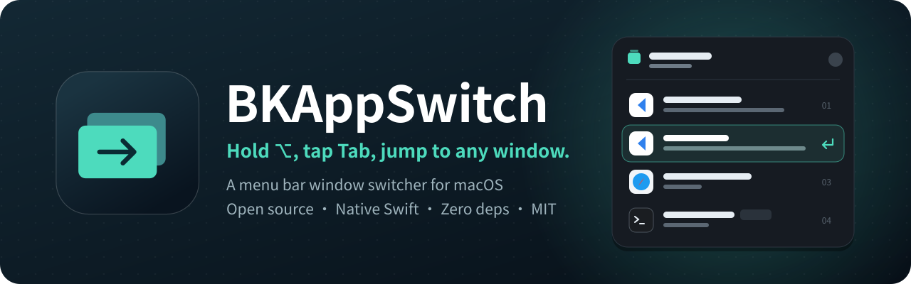
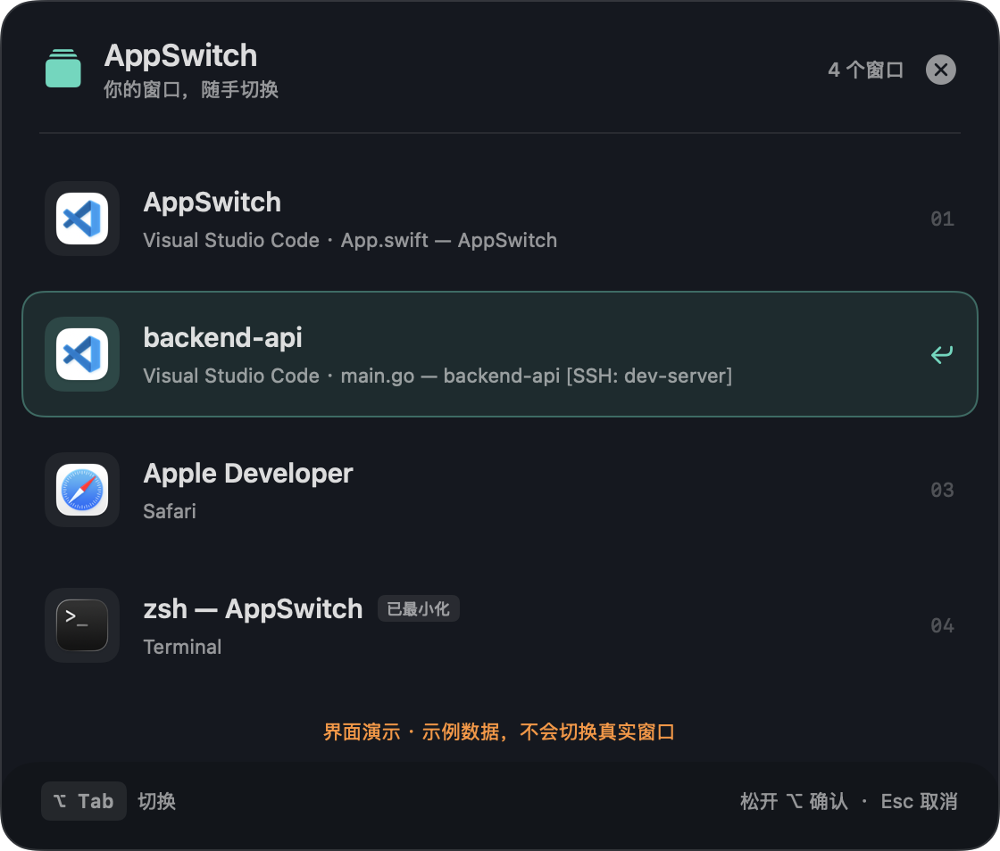
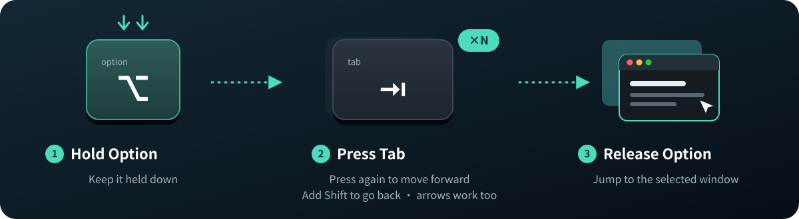
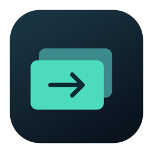

<div align="center">



<p>
  <a href="LICENSE"></a>
  
  
  
</p>

[简体中文](README.md) · **English**

[✨ Features](#-features) · [🚀 Getting started](#-getting-started) · [⚡ Shortcuts](#-keyboard-shortcuts) · [❓ FAQ](#-faq) · [🤝 Contributing](#-contributing)

</div>

---

## 👋 About

**AppSwitch** is an open-source window switcher that lives in the macOS menu bar.

Juggling several VS Code projects plus a browser and a terminal? The built-in `⌘ Tab` only switches between apps. AppSwitch puts **every window** of the apps you choose into a single list: hold `⌥`, tap `Tab`, and you land on exactly the window you want.

- 🪶 Native Swift + SwiftUI + AppKit, **no third-party dependencies**
- 🔒 **No network requests**, no project files read, no account
- 📄 Released under the [MIT License](LICENSE): free to use, modify and distribute

> [!NOTE]
> The app's interface is currently in **Simplified Chinese** only. This README gives an English translation next to each menu item and setting it mentions, e.g. 设置与权限… (*Settings & Permissions…*).

## 📸 Preview

<div align="center">
  
</div>

<sub>Windows from different apps share one list. The highlighted row is the current selection. VS Code windows show the project name first and keep the original title underneath, and minimized windows get a badge (已最小化). The screenshot uses built-in demo data, not real work.</sub>

## 🎯 How it works

<div align="center">
  
</div>

## ✨ Features

| | Feature | Details |
| :-: | --- | --- |
| 🧩 | **Pick your apps** | VS Code is included by default. Add any `.app`, and pause or remove apps at any time |
| 🪟 | **Switch by window** | Jump straight to a specific project or window, shown with the app's real icon |
| 📌 | **Stable order** | Existing windows keep their relative position while AppSwitch runs, and new windows are added at the end |
| ⌨️ | **Keyboard and mouse** | Reverse selection, arrow keys, release ⌥ to confirm, Esc to cancel, click to jump |
| 🔽 | **Restores minimized windows** | Picking a minimized window restores and focuses it |
| 🖥️ | **Finds windows on other Spaces** | Uses the Accessibility API and the app's native Window menu to fill in window information |
| 🏷️ | **VS Code project names** | Pulls the project name out of the window title, with a configurable detection mode |
| 🔒 | **Runs entirely locally** | Reads no file contents, sends no window titles and needs no account |

## 💻 Requirements

| Item | Requirement |
| --- | --- |
| 🍎 OS | macOS 13 Ventura or later |
| 📦 Prebuilt DMG | The packaging script builds for Apple silicon (arm64). On an Intel Mac, build from source and test it |
| 🛠️ Building from source | Xcode or the Command Line Tools, with Swift 5.9+ |
| ✅ Required permission | Accessibility (to read and switch windows) |
| 🚫 Not required | Input Monitoring, Screen Recording |

## 🚀 Getting started

### Option 1: Build from source (recommended)

Open Terminal and run:

```sh
git clone https://github.com/binbinku/AppSwitch.git
cd AppSwitch
zsh scripts/build-app.sh
zsh scripts/install-app.sh
open /Applications/AppSwitch.app --args --settings
```

The build produces `dist/AppSwitch.app`, and the install script copies it to `/Applications/AppSwitch.app`. If you don't have the build tools yet, run `xcode-select --install` and follow the prompts.

> [!TIP]
> Install to Applications *before* granting permissions, and always run that one copy. The build and install scripts refuse to overwrite a running AppSwitch, so quit it from the menu bar before upgrading.

### Option 2: Install the DMG

If [Releases](https://github.com/binbinku/AppSwitch/releases) has a disk image, you can download it and skip the developer tools:

1. Download the `.dmg` for your Mac.
2. Open it and drag **AppSwitch** to **Applications**.
3. Eject the image and launch AppSwitch from Applications.
4. Grant Accessibility access as described below.

> [!NOTE]
> The current image is for Apple silicon Macs only. It uses a local ad-hoc signature and is **not notarized by Apple**. If macOS blocks it the first time you open it, make sure you trust the source, then allow it under **System Settings → Privacy & Security**.

### 🔑 First launch: grant access and pick apps

1. AppSwitch lives in the **menu bar at the top of the screen** and has no Dock icon. Click the stacked-windows icon and choose **设置与权限…** (*Settings & Permissions…*).
2. Click **授权辅助功能** (*Grant Accessibility*) to open **System Settings → Privacy & Security → Accessibility**.
3. Add and enable `/Applications/AppSwitch.app`. If needed, quit AppSwitch and open it again. Access is granted once the settings window shows **辅助功能：已授权** (*Accessibility: Granted*).
4. Under **参与切换的应用** (*Apps to switch between*), keep VS Code or click **添加应用…** (*Add App…*) to add others, and make sure their toggles are on.
5. Open some windows in those apps, hold `⌥` and press `Tab` to start switching 🎉

Adding an app doesn't launch it. The list only shows apps that are enabled, running and able to report their windows. Removing an app doesn't close any of its windows.

## ⚡ Keyboard shortcuts

These are the defaults. The Option key is also shown as `⌥` or `Alt`.

| Action | Result |
| --- | --- |
| Hold `⌥`, press `Tab` | Open the list and select the next window |
| Keep holding `⌥`, press `Tab` again | Cycle forward |
| `⌥` `⇧ Shift` `Tab` | Cycle backward |
| Release `⌥` / press `Return` | Confirm and switch |
| `↑` `↓` arrow keys | Move the selection |
| `Esc` / click outside / click the close button | Cancel |
| Click a row | Jump to that window immediately |

You can also click **显示窗口列表** (*Show Window List*) in the menu bar to keep the list open, then click a window or press Return.

In settings, you can change the trigger to `⌃ ⌥ Tab` or `⌥ Space`. With any trigger, releasing `⌥` confirms and adding Shift reverses the direction.

### 📌 Why doesn't the list reorder by recent use?

Windows that stay in place are easier to find by memory. While AppSwitch runs, existing windows keep their relative order. New windows go to the end and closed ones drop out. Recent use only decides the **initial selection**, so you can jump back to your previous window quickly, but rows never move. The order is rebuilt when AppSwitch restarts.

### 🏷️ Clearer VS Code project names

AppSwitch tries to detect the project name in VS Code window titles. If you use a custom title, choose **项目名在前** (*Project name first*), **文件名在前** (*File name first*) or **完整原始标题** (*Full original title*) in settings.

We recommend adding this to your **user-level** VS Code `settings.json`, then setting AppSwitch to *Project name first*:

```json
{
  "window.title": "${rootName}${separator}${activeEditorShort}"
}
```

Detection is heuristic, and the full original title is always kept. To tell projects with the same name apart, use `${rootPath}` or different `.code-workspace` names. Title detection only applies to the VS Code family; other apps show their full window titles. AppSwitch never changes your VS Code settings and needs no extension.

## ❓ FAQ

<details>
<summary><b>I launched it but there's no window and no Dock icon</b></summary>

<br>

AppSwitch is a menu bar app, so it has no Dock icon while running. Click the stacked-windows icon at the top of the screen and choose 设置与权限… (*Settings & Permissions…*), or run:

```sh
open /Applications/AppSwitch.app --args --settings
```

</details>

<details>
<summary><b>The Accessibility toggle is on, but AppSwitch still says it isn't authorized</b></summary>

<br>

The local ad-hoc signature can change when you rebuild or upgrade, and macOS may not apply the old grant to the new binary:

1. Quit AppSwitch from the menu bar and make sure the new version is installed in its usual location.
2. Remove the old AppSwitch entry from the Accessibility list.
3. Add `/Applications/AppSwitch.app` again, turn it on, and launch AppSwitch from that path.
4. Check the running app's path and authorization status in AppSwitch's settings (当前运行的应用, *Currently running app*).

Don't run the copy in `dist` and the one in Applications at the same time.

</details>

<details>
<summary><b>Nothing happens when I press the shortcut</b></summary>

<br>

First, try **显示窗口列表** (*Show Window List*) from the menu bar. If the list opens, check in settings whether the system hotkey (系统热键) registered, then try another combination and click **重新检查** (*Check again*). Another app may already be using the hotkey, and the settings window shows the system error code and the last time the hotkey fired. The trigger hotkey itself doesn't need Accessibility access, but reading and switching windows does.

</details>

<details>
<summary><b>The list is empty, or an app's windows are missing</b></summary>

<br>

Make sure the app is added, enabled, running and has windows open, and that AppSwitch has Accessibility access. The target app has to expose its windows through macOS Accessibility or its native Window menu, so how well this works varies between apps.

</details>

<details>
<summary><b>Can it switch to other Spaces or full-screen windows?</b></summary>

<br>

AppSwitch finds windows through Accessibility and the app's native Window menu, and switches using interfaces the target app provides. It doesn't use private Spaces APIs. Results with different apps, full-screen windows and multiple displays need to be tested on real setups.

If it doesn't move you to the right Space, check **System Settings → Desktop & Dock → Mission Control → "When switching to an application, switch to a Space with open windows for the application"**.

</details>

<details>
<summary><b>Will it interfere with the original CodeSwitch?</b></summary>

<br>

No. AppSwitch has its own name and bundle ID (`dev.appswitch.app`) and installs to `/Applications/AppSwitch.app`. It doesn't replace CodeSwitch or migrate its preferences, so you need to grant access and set up your app list again. If you run both, give them different shortcuts. You can also try AppSwitch's demo mode first.

</details>

<details>
<summary><b>Does it launch at login? How do I uninstall it?</b></summary>

<br>

There's no built-in launch-at-login switch yet. To launch it at login, add AppSwitch under **System Settings → General → Login Items**.

To uninstall, quit AppSwitch from the menu bar and move AppSwitch.app to the Trash. You can also remove its entries from Accessibility and Login Items.

</details>

## 🔒 Privacy & permissions

- 🛡️ **Accessibility** is used to read window titles, identify windows and focus the one you pick. You grant it yourself.
- 📴 The app makes **no network requests**, uploads no window titles and reads no project files.
- 💾 Your app list, shortcut and title detection mode are stored in local preferences.
- 🙅 No Input Monitoring or Screen Recording permission is needed.
- 🩺 A diagnostics file is written only when you pass the flag explicitly. It holds state, counts and the running path, never window titles or file contents.

## 🛠️ Development

### Test and build

```sh
swift test
zsh scripts/build-app.sh
```

Unit tests cover the core logic: stable window order, recent-window selection, menu rebuilding, app list persistence, title detection, cycling in both directions, and fast key presses and cancellation while the list is loading. System authorization, Spaces, full-screen and multi-display behavior still need testing on real machines.

### 🎭 Demo mode

You can preview the UI without granting any permissions:

```sh
open -n dist/AppSwitch.app --args --demo
```

Demo mode uses sample data, registers no system hotkey and never switches real windows. In normal mode, the settings window also has a UI preview entry (界面预览).

### 🩺 Diagnostics

To troubleshoot, pass an explicit path for the diagnostics file:

```sh
open dist/AppSwitch.app --args --diagnostic-file /tmp/appswitch-status.json
```

### 📦 Packaging and signing

```sh
zsh scripts/package-release.sh
```

This produces `dist/AppSwitch-<version>-macOS-arm64.dmg` and a matching `.sha256` checksum file. The image contains the app, an Applications shortcut and installation notes in Chinese. Packaging happens in a separate directory, and the script stops instead of overwriting an existing release file with the same name.

Local builds use an ad-hoc signature by default. If you have an Apple Developer signing identity, pass it in:

```sh
APPSWITCH_SIGN_IDENTITY='Developer ID Application: Your Name (TEAMID)' zsh scripts/build-app.sh
```

Public distribution should use a Developer ID signature and Apple notarization. The scripts don't automate notarization yet.

### 🗂️ Project layout

```text
AppSwitch/
├── Sources/
│   ├── AppSwitch/          # Menu bar entry, settings UI, window list, hotkeys, Accessibility
│   └── AppSwitchCore/      # Title detection, app selection, stable ordering, switch state (testable)
├── Tests/
│   └── AppSwitchCoreTests/ # Unit tests for the core logic
├── Resources/              # Info.plist, icon generator, install notes
├── scripts/                # Build, install, running-app check, DMG packaging
└── docs/images/            # README images
```

## 🤝 Contributing

Contributions of all kinds are welcome 💚

- 🐛 **Report a bug** in [Issues](https://github.com/binbinku/AppSwitch/issues). For window compatibility problems, include your macOS version, chip, AppSwitch version, the target app and its version, steps to reproduce, and whether full-screen or multiple Spaces are involved.
- 💡 **Suggest an idea** in Issues as well.
- 🔧 **Send code** as a [Pull Request](https://github.com/binbinku/AppSwitch/pulls). Run `swift test` and the build script first. If your change touches window interaction, list the apps and scenarios you tested.
- 🌍 **Help translate.** An English UI would be a great contribution.

> [!WARNING]
> Check screenshots and diagnostics for private information and remove it before sharing.

## 📄 License

Released under the [MIT License](LICENSE) © 2026 [binbinku](https://github.com/binbinku).

You're free to use, modify and distribute this project, as long as you keep the copyright and license notice.

<div align="center">
  <br>
  
  <br>
  <sub>If AppSwitch helps you, a ⭐️ would mean a lot</sub>
</div>
